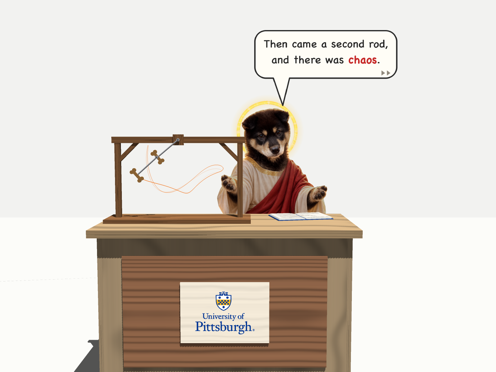

# Dog Jesus Teaches the Double Pendulum


A small 3D scene made with SoQt/Coin for my Computational Physics class. A double-pendulum teaching model stands on a lectern, and the teacher, a plywood cutout of my dog dressed as Jesus, is mounted on a springy stick behind the desk and preaches *The Sermon on the Pendulum*, one speech bubble at a time. Both the pendulum and the teacher start at rest; they only move after you pull them with the mouse.



## What is simulated

- **The double pendulum.** Two aluminium rods with a bone biscuit fixed at the end of each. The masses of the rods and the biscuits' own moments of inertia are included. The Lagrangian gives a 2×2 linear system for the two angular accelerations, which is integrated with RK4 at dt = 1/1200 s (20 steps per animation frame). The orange line is the path of the lower biscuit over the last 2 s.
- **The teacher.** The cutout is fixed to a stick with a torsion spring at the bottom, so it is an inverted pendulum with a spring: I φ̈ = −kφ + Mgh sin φ. I and Mh come from the area moments of the dog's outline (Green's theorem), plus the halo ring and the stick.

## Build and run

Needs Qt 6, Coin and SoQt (the same setup as the Chapter 10 examples).

```bash
cd double_pendulum
cmake -S . -B build && cmake --build build
./build/double_pendulum
```

Run it from `double_pendulum/`, where the pictures are. Drag to turn the view, scroll to zoom. Press **Esc** to switch to the arrow, then:

- drag a biscuit to choose where the pendulum starts; it waits while you hold it and starts from rest when you let go. A moving biscuit doesn't have to be hit exactly: a press within 10 cm of it, or of where it was in the last quarter second, catches it
- drag the dog teacher sideways to tilt him (up to 20°); he rocks from there when you let go, so the tilt you leave him at is how far he rocks
- click the speech bubble (or press **N** or **→**) to skip to the next line of the sermon

Press Esc again to go back to turning the view. Every 10 s the terminal prints how much the pendulum's energy has changed since it was last let go.

## Files

| File | What it does |
|---|---|
| `double_pendulum/DoublePendulum.h` | equations of motion and RK4 |
| `double_pendulum/SwayingBoard.h` | the teacher's rocking |
| `double_pendulum/DogBoard.h` | the cutout: outline from the mask, printed photo, halo, stick and base |
| `double_pendulum/ClassroomScene.h` | room, lectern, stand, rods and biscuits, book, Pitt plaque, shadows |
| `double_pendulum/SpeechBubble.h`, `Sermon.h` | the speech bubbles and what the teacher says |
| `double_pendulum/SceneTools.h` | wood textures and simple shapes |
| `double_pendulum/MouseControl.h` | dragging the biscuits and the dog, and skipping lines with the mouse or keyboard |
| `double_pendulum/main.cpp` | window, timer and animation |

`main.cpp` and `CMakeLists.txt` in this folder are my first SoQt test (a cone). `dog.JPG` is my dog, and `dog_jesus.PNG` is the AI-generated picture used for the cutout. How the project grew is in [note.txt](note.txt).

<details>
<summary>The Sermon on the Pendulum (spoilers)</summary>

1. In the beginning was the Lagrangian.
2. And the Lagrangian was T − V, and it was good.
3. Blessed are the small angles, for they shall be linear.
4. Then came a second rod, and there was chaos.
5. Let him who is without sin θ cast the first biscuit.
6. I can walk on water. I cannot predict this pendulum.
7. Fear not! I bring you good tidings: energy is conserved.
8. Blessed are the treats, for they are sensitive to initial conditions.
9. Go forth and integrate. (RK4, dt = 1/1200 s)
10. Peace be with you. Homework is due Friday.

</details>

The University of Pittsburgh mark on the desk comes from the official brand files and is used here only for a class project.
